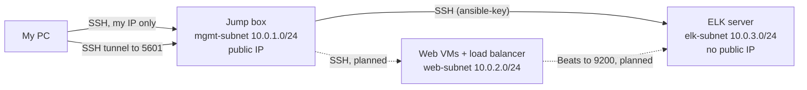

# Azure SOC Lab: segmented network, jump box and ELK SIEM

A hands-on lab that builds the core of a small Security Operations Center in Azure:
a segmented virtual network, locked-down firewalls, a jump box as the single admin
entry point, and an Elasticsearch + Kibana server to act as the SIEM.

**Status: Phase 1 complete (infrastructure and SIEM core). Phase 2 not built** (see
[Not completed](#not-completed)). The Azure free credit expired mid-project, so the
subscription became read-only before I could deploy the web tier.

## Architecture

Solid lines were built and tested. Dashed lines were designed (NSG rules exist) but
the VMs behind them were never deployed. More detail in [docs/architecture.md](docs/architecture.md).

## What was built

| Component | Details |
|---|---|
| Resource group | `soc-lab-rg`, Austria East |
| Virtual network | `soc-vnet`, `10.0.0.0/16`, three subnets (mgmt, web, elk) |
| NSGs | `mgmt-nsg`, `web-nsg`, `elk-nsg`, each attached to its subnet |
| Jump box | Ubuntu 22.04 VM with the only public IP, key-based SSH, Docker, my own Ansible image |
| ELK server | Ubuntu 22.04 VM, no public IP, Elasticsearch + Kibana 9.1.0 in Docker Compose |

## Security design

- **Only one machine is reachable from the internet** (the jump box), and only over SSH from my own IP.
- **Internal VMs have no public IPs.** SSH to them is allowed only from the management subnet.
- **Kibana is never exposed.** I reach it through an SSH tunnel via the jump box.
- **Explicit deny between tiers.** Azure's default `AllowVnetInBound` rule lets every VM in a
  VNet talk to every other, which defeats subnet segmentation. A priority-4000 deny rule on the
  web and ELK subnets closes that gap, after the specific allows.
- **Separate key for internal access.** The jump box has its own key pair; internal VMs accept only that key.
- **Own Ansible image** built from `python:3.12-slim` instead of a third-party image, because the container holds the key to every other VM.

| NSG | Subnet | Rules |
|---|---|---|
| `mgmt-nsg` | mgmt | 100 allow SSH from my IP |
| `web-nsg` | web | 100 allow SSH from mgmt, 110 allow HTTP 80 from my IP, 4000 deny other VNet traffic |
| `elk-nsg` | elk | 100 allow SSH from mgmt, 110 allow 5044/9200 from web, 120 allow Kibana 5601 from mgmt, 4000 deny other VNet traffic |

Lab trade-off: Elasticsearch security (`xpack.security`) is disabled to keep the lab simple,
justified by the private network and NSGs. A production SIEM would enable authentication and TLS.

## Reproduce it

1. Copy `network/env.example.sh` to `network/env.sh` and fill in your values (git-ignored).
2. `source network/env.sh && bash network/create-network.sh`
3. Generate an SSH key on your PC, then `bash network/create-jumpbox.sh`
4. Follow [jumpbox/README.md](jumpbox/README.md) to install Docker and build the Ansible image.
5. Put the jump box's public key in `ANSIBLE_PUBLIC_KEY`, then `bash network/create-elk-vm.sh`
6. Follow [elk/README.md](elk/README.md) to start Elasticsearch and Kibana.

The scripts were consolidated from the commands I ran interactively in Azure Cloud Shell;
I could not re-run them end to end after the subscription was disabled, so expect to fix small details.

## Lessons learned

The most useful part of the project. Full list in [docs/troubleshooting.md](docs/troubleshooting.md):

- Default NSG rules allow all VNet-internal traffic, so "allow SSH from the jump box" does not
  segment anything without an explicit deny.
- `az vm list-sizes` (deprecated) wrongly suggested sizes were available; `az vm list-skus`
  showed that B-series sizes were restricted on my subscription.
- New subscriptions have low regional vCPU quotas (4 here), which caps how many VMs a lab can run.
- Cloud Shell is ephemeral, so every step needs to be scripted.
- Free accounts stop when the credit expires, so budget the build before starting.

## Not completed

- Web VMs running Docker (DVWA) behind an Azure Load Balancer
- Ansible inventory and playbooks to configure them
- Filebeat and Metricbeat log shipping to Elasticsearch
- Kibana dashboards, alert rules and attack simulations (failed SSH logins, web scans)

These were blocked by the quota limit and then by the expired free credit.

## Tech

Azure CLI, Azure VNets and NSGs, Ubuntu 22.04, Docker, Docker Compose, Ansible,
Elasticsearch, Kibana, SSH tunnelling.
