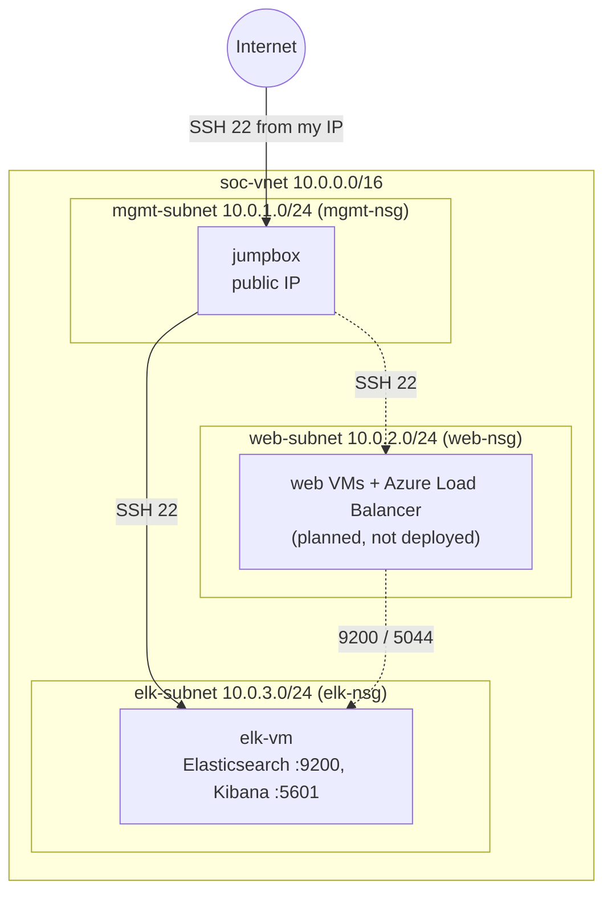

# Architecture

## Why three subnets

Each tier has a different job and a different trust level:

- **mgmt**: the administrative entry point. The only tier reachable from outside.
- **web**: intentionally vulnerable targets I would monitor and attack. Assumed to be compromisable.
- **elk**: the SIEM. Log evidence must stay out of an attacker's reach even if a web VM is compromised.

## How traffic is controlled

NSG rules are evaluated lowest priority number first; the first match wins. Azure adds default
rules at 65000+ that allow all traffic inside the VNet and deny everything else from the internet.
Because the VNet-wide allow exists, I added an explicit deny at priority 4000 so that only the
specific allows above it (100 to 120) work between tiers.

NSGs are stateful and work at layers 3 and 4: they restrict who can reach which port, but do not
inspect traffic. Attacks that arrive over an allowed port (for example HTTP to a vulnerable web app)
are what the SIEM is meant to detect.

## Access paths

| Path | How |
|---|---|
| PC to jump box | SSH with `soc-lab-key`, allowed by `mgmt-nsg` from my IP |
| Jump box to other VMs | SSH with `ansible-key`, allowed by `web-nsg` / `elk-nsg` from 10.0.1.0/24 |
| PC to Kibana | SSH tunnel through the jump box (`-L 5601:<elk-ip>:5601`) |
| Web VMs to Elasticsearch | Beats to 9200, allowed by `elk-nsg` from 10.0.2.0/24 (planned) |

## Sizing notes

VM sizes were chosen by what my subscription allowed (D-series, because B-series was restricted):
jump box 2 vCPU / 4 GB, ELK server 2 vCPU / 8 GB with a 64 GB OS disk. Elasticsearch gets a 2 GB
heap inside a 4 GB container limit.
